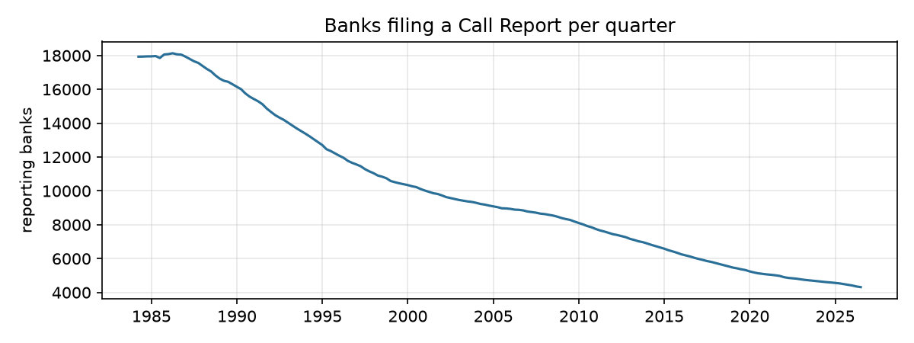
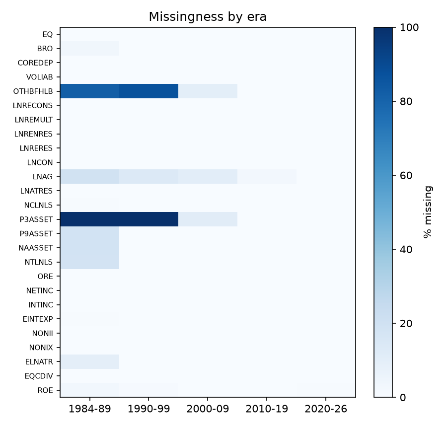

# Automated data-quality report
Generated by `src/03_quality.py` from the curated layer. All numbers are recomputed on every run.

## Summary of issues and handling

| check                         | finding                                                                              | rows/banks affected   | handling in pipeline                                                                                                                     |
|:------------------------------|:-------------------------------------------------------------------------------------|:----------------------|:-----------------------------------------------------------------------------------------------------------------------------------------|
| Completeness                  | 0 quarters with row count != API total                                               | 0                     | download re-run until 0 (resumable manifest)                                                                                             |
| Primary key                   | 0 duplicate (CERT, REPDTE)                                                           | 0                     | assert in panel build (pipeline fails if > 0)                                                                                            |
| Structural missingness        | fields not collected in early years: OTHBFHLB, P3ASSET                               | 2                     | never imputed with future info: missing-indicator + training-block median; columns empty in a training block are dropped for that block  |
| Negative stock amounts        | negative values in fields that cannot be negative                                    | 860                   | set to null (treated as a reporting error)                                                                                               |
| Extreme ratios                | ratios far outside economic range (tiny denominators)                                | 21397                 | ratios recomputed from amounts with safe division; winsorised at train-period 0.5/99.5 pct                                               |
| Zero used as missing          | risk-based capital ratios are 0 instead of null (pre-1990, and CBLR banks from 2020) | 100% of 1984-89 rows  | capital ratios not used as model features; equity/assets (eq_ta), which exists in all eras, is used instead                              |
| Negative equity               | insolvent banks report EQ < 0                                                        | 15659                 | kept: genuine (and highly informative) signal, not an error                                                                              |
| Accounting identities         | small share of rows break balance-sheet identities                                   | 12940                 | rows kept: DEP > ASSET coincides with negative equity (insolvency), the rest is <0.05% of rows; ratios use safe division and winsorising |
| YTD flows                     | income items are cumulative within the calendar year                                 | all rows              | de-cumulated: flow_q = YTD_q - YTD_{q-1} (same year, consecutive quarter), Q1 = YTD; annualised x4; null when previous quarter missing   |
| Reporting gaps                | missing quarters inside a bank's reporting history                                   | 32 banks              | lags/changes computed on the quarter index, not on row order; null when gap                                                              |
| Failures without Call Reports | in-scope failure events whose CERT never appears in Financials                       | 6                     | cannot be labelled; reported as a (tiny) coverage limitation                                                                             |
| Reports after FAILDATE        | failed institution keeps filing after FAILDATE (1989 RTC conservatorships)           | 271                   | rows with REPDTE >= FAILDATE are dropped; label uses the first FAILURE date                                                              |
| Repeated events per CERT      | assistance followed by failure, or two failures                                      | 44                    | first RESTYPE = FAILURE event defines the label; assistance is not a failure                                                             |
| Exit classification           | banks that stop reporting: failure vs. merger/other                                  | 19751 exited banks    | failure iff CERT in Failures with RESTYPE=FAILURE; other exits keep label 0 and leave the panel after their last report                  |
| Orphan CERTs                  | CERTs in Financials missing from Institutions                                        | 235                   | kept (Institutions not needed for features)                                                                                              |
| Static attributes             | Institutions holds current, not historical, BKCLASS/STNAME/SPECGRP                   | 4518 banks            | use quarter-specific BKCLASS/STNAME from Financials                                                                                      |
| Exit fields                   | ACTIVE/ENDEFYMD/CHANGEC are future information                                       | all                   | never used as features                                                                                                                   |
| Schema drift                  | column dtypes differ between quarter files                                           | 20                    | explicit schema cast in 02_storage.py                                                                                                    |

## 1. Completeness of the download
* Quarters: **170** (1984-03-31 to 2026-06-30); rows: **1,682,616**; quarters where rows != API total: **0**.
* Failures: 4,117 rows (API total 4,117); Institutions: 27,835 rows (API total 27,835).

## 2. Primary key (CERT, REPDTE)
* rows 1,682,616, unique keys 1,682,616, duplicates **0**, null CERT 0.

## 3. Missing values by era
| column   |   1984-89 |   1990-99 |   2000-09 |   2010-19 |   2020-26 |
|:---------|----------:|----------:|----------:|----------:|----------:|
| EQ       |       0.2 |       0.3 |       0.2 |       0.3 |       0.4 |
| BRO      |       3.2 |       0.3 |       0.2 |       0.3 |       0.4 |
| COREDEP  |       0.0 |       0.0 |       0.0 |       0.3 |       0.4 |
| VOLIAB   |       0.2 |       0.3 |       0.2 |       0.3 |       0.4 |
| OTHBFHLB |      82.1 |      86.8 |      10.1 |       0.3 |       0.4 |
| LNRECONS |       0.2 |       0.3 |       0.2 |       0.0 |       0.0 |
| LNREMULT |       0.2 |       0.3 |       0.2 |       0.0 |       0.0 |
| LNRENRES |       0.2 |       0.3 |       0.2 |       0.0 |       0.0 |
| LNRERES  |       0.2 |       0.3 |       0.2 |       0.0 |       0.0 |
| LNCON    |       0.1 |       0.3 |       0.2 |       0.3 |       0.4 |
| LNAG     |      19.4 |      13.5 |      10.2 |       2.4 |       0.4 |
| LNATRES  |       0.2 |       0.3 |       0.2 |       0.3 |       0.4 |
| NCLNLS   |       0.6 |       0.0 |       0.0 |       0.0 |       0.0 |
| P3ASSET  |     100.0 |     100.0 |      11.1 |       0.0 |       0.0 |
| P9ASSET  |      18.5 |       0.0 |       0.0 |       0.0 |       0.0 |
| NAASSET  |      18.5 |       0.0 |       0.0 |       0.0 |       0.0 |
| NTLNLS   |      18.3 |       0.3 |       0.2 |       0.3 |       0.4 |
| ORE      |       0.2 |       0.3 |       0.2 |       0.3 |       0.4 |
| NETINC   |       0.3 |       0.3 |       0.2 |       0.3 |       0.4 |
| INTINC   |       0.3 |       0.3 |       0.2 |       0.3 |       0.4 |
| EINTEXP  |       0.7 |       0.3 |       0.2 |       0.3 |       0.4 |
| NONII    |       0.3 |       0.3 |       0.2 |       0.3 |       0.4 |
| NONIX    |       0.3 |       0.3 |       0.2 |       0.3 |       0.4 |
| ELNATR   |       9.5 |       0.3 |       0.2 |       0.3 |       0.4 |
| EQCDIV   |       0.3 |       0.3 |       0.2 |       0.3 |       0.4 |
| ROE      |       3.0 |       0.8 |       0.2 |       0.3 |       0.5 |
Values are % of rows missing.

## 4. Domain and range violations
| rule                             |   rows |
|:---------------------------------|-------:|
| RBCRWAJ > 100 % (tiny RWA)       |  18077 |
| EQ < 0 (balance-sheet insolvent) |  15659 |
| RBC1AAJ > 100 %                  |   2786 |
| ORE < 0                          |    646 |
| ASSET < 1 000 (under $1m)        |    550 |
| EQV > 100 % or < -100 %          |    290 |
| |ROA| > 100 %                    |    244 |
| SC < 0                           |     96 |
| LNLSNET < 0                      |     50 |
| LNLSGR < 0                       |     32 |
| INTINC < 0                       |     12 |
| LNATRES < 0                      |      9 |
| LNRE < 0                         |      6 |
| NCLNLS < 0                       |      3 |
| CHBAL < 0                        |      2 |
| NAASSET < 0                      |      2 |
| LNCI < 0                         |      2 |
Share of rows where a capital ratio is exactly 0 (a bank cannot operate with 0% capital, so 0 = not reported). Before 1990 risk-based ratios did not exist; from 2020 small banks that opt into the Community Bank Leverage Ratio framework stop reporting risk-based ratios:
| era     |   RBCRWAJ == 0 (%) |   IDT1RWAJR == 0 (%) |   RBC1AAJ == 0 (%) |
|:--------|-------------------:|---------------------:|-------------------:|
| 1984-89 |             100.00 |               100.00 |              18.13 |
| 1990-99 |               0.31 |                 0.84 |               0.30 |
| 2000-09 |               0.22 |                 1.17 |               0.22 |
| 2010-19 |               0.26 |                 1.18 |               0.26 |
| 2020-26 |              37.15 |                37.98 |               0.36 |

## 5. Accounting identities (cross-field consistency)
| identity violated                                |   rows |   % rows |
|:-------------------------------------------------|-------:|---------:|
| LNLSNET != LNLSGR - LNATRES (>1%)                |      6 |    0.000 |
| EQV != 100*EQ/ASSET (>1% rel.)                   |      0 |    0.000 |
| DEP > ASSET                                      |   6204 |    0.369 |
| DEPDOM > DEP                                     |      0 |    0.000 |
| LNLSGR > ASSET                                   |    761 |    0.045 |
| RE components > LNRE                             |      6 |    0.000 |
| NAASSET > NCLNLS + ORE (nonaccrual > noncurrent) |   5963 |    0.354 |

## 6. Income-statement flows are year-to-date (YTD)
Call Report income items (NETINC, INTINC, EINTEXP, NONII, NONIX, ELNATR, NTLNLS, EQCDIV) accumulate from January. If used raw, Q4 values look ~4x Q1 values, and a feature like NETINC/ASSET would be seasonal noise.
| quarter   |   median INTINC/ASSET |   median ROA (%) |
|:----------|----------------------:|-----------------:|
| Q1        |                0.0174 |           0.9739 |
| Q2        |                0.0346 |           0.9899 |
| Q3        |                0.0517 |           0.9945 |
| Q4        |                0.0677 |           0.9484 |
INTINC/ASSET rises linearly Q1->Q4 (YTD) while ROA is flat (already annualised by the FDIC).

## 7. Reporting gaps inside a bank's history
* 33 gaps (a missing quarter between two reports) in **32** banks; median gap 1 quarter(s), max 30 quarters.

## 8. Failures table
| RESTYPE    |   events |   no financials |
|:-----------|---------:|----------------:|
| FAILURE    |     2848 |               6 |
| ASSISTANCE |      411 |               0 |
* Null CERT: 488 rows, of which **0** inside the 1984-2026 scope (all null-CERT events are pre-1984 resolutions). Events before scope: 858.
* 44 CERTs appear more than once (e.g. open-bank assistance followed later by failure). The label uses the first event with RESTYPE = FAILURE:
| events                |   banks |
|:----------------------|--------:|
| FAILURE+FAILURE       |       3 |
| ASSISTANCE+FAILURE    |      37 |
| ASSISTANCE+ASSISTANCE |       4 |
Days between the last Call Report and FAILDATE:
| RESTYPE    | bucket                       |    n |
|:-----------|:-----------------------------|-----:|
| ASSISTANCE | <=0 (reported after failure) |  176 |
| ASSISTANCE | 1-92                         |  222 |
| ASSISTANCE | 93-183                       |   13 |
| FAILURE    | <=0 (reported after failure) |  271 |
| FAILURE    | 1-92                         | 2242 |
| FAILURE    | 93-183                       |  319 |
| FAILURE    | 184-365                      |   10 |
271 FAILURE events have Call Reports dated on/after FAILDATE. They are concentrated in:
| SAVR   |   FAILYR |   n |   median_days |
|:-------|---------:|----:|--------------:|
| RTC    |     1989 | 226 |          -362 |
| FSLIC  |     1985 |  14 |          -155 |
| RTC    |     1990 |  13 |           -36 |
| FSLIC  |     1986 |  11 |          -608 |
| RTC    |     1991 |   5 |          -144 |
| FSLIC  |     1988 |   1 |          -344 |
| FDIC   |     1988 |   1 |             0 |
These are mainly savings institutions placed in RTC conservatorship in 1989: FAILDATE is the date of takeover and the institution kept filing until it was resolved. The event is public at FAILDATE, so all reports dated on/after FAILDATE are dropped from the panel.

## 9. Exits: failure vs. other exits (Institutions table)
|   CHANGEC1 |   exited_banks |   in_Failures_table |   % failed |
|-----------:|---------------:|--------------------:|-----------:|
|      223.0 |        14183.0 |                 2.0 |        0.0 |
|      211.0 |         2393.0 |              2376.0 |       99.3 |
|      221.0 |          808.0 |                 1.0 |        0.1 |
|      217.0 |          647.0 |               159.0 |       24.6 |
|      240.0 |          504.0 |                 0.0 |        0.0 |
|      213.0 |          337.0 |                95.0 |       28.2 |
|      nan   |          194.0 |                 0.0 |        0.0 |
|      230.0 |          191.0 |               180.0 |       94.2 |
|      224.0 |          184.0 |                 0.0 |        0.0 |
|      222.0 |          173.0 |                 0.0 |        0.0 |
|      235.0 |          109.0 |                25.0 |       22.9 |
|      216.0 |           23.0 |                 0.0 |        0.0 |
Code 211 is the usual 'failure' code, but only 83.6% of failed banks carry it (others carry merger-type codes 213/217/235 that also occur for healthy mergers), and 17 banks with 211 are not in the Failures table. CHANGEC is therefore NOT used to define failure: the Failures table (RESTYPE = FAILURE) is the authoritative source; every other exit (merger, voluntary liquidation, charter conversion) has label 0.

## 10. Point-in-time traps
* 4,518 of 24,064 banks (18.8%) changed charter class (BKCLASS) and 249 changed state over time. The Institutions table stores only the **latest** value, so joining it to old quarters would leak today's information into the past.
* Institutions fields ACTIVE, ENDEFYMD, CHANGEC*, INACTIVE describe the bank's *end* of life: using them as features is direct look-ahead. The pipeline uses Institutions only to *classify exits for the label*.
* The API serves the latest revised (amended) value of each Call Report, not the vintage first published ~30-45 days after quarter end. Restatements cannot be detected from this source (limitation).

## 11. Type drift in the raw files
* 20 columns change physical type between raw quarter files (e.g. int64 in one quarter, double when a null appears). The curated layer enforces one schema (amounts Int64, ratios Float64, REPDTE Date).
| column   |   n_distinct_dtypes | dtypes        |
|:---------|--------------------:|:--------------|
| DEP      |                   2 | double, int64 |
| DEPDOM   |                   2 | double, int64 |
| CHBAL    |                   2 | double, int64 |
| SC       |                   2 | double, int64 |
| COREDEP  |                   2 | double, int64 |
| LNLSGR   |                   2 | double, int64 |
| LNLSNET  |                   2 | double, int64 |
| LNRE     |                   2 | double, int64 |
| LNRECONS |                   2 | double, int64 |
| LNREMULT |                   2 | double, int64 |
| LNRENRES |                   2 | double, int64 |
| LNRERES  |                   2 | double, int64 |
| LNCI     |                   2 | double, int64 |
| LNCON    |                   2 | double, int64 |
| NCLNLS   |                   2 | double, int64 |
